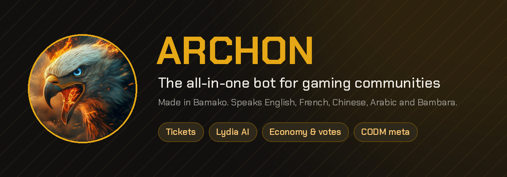

## Sending credits is now one tap away

**New**
- /credit has a Send button: pick a member, type the amount, done. /transfer and .pay ask you to confirm first.
- Daily bonus reminders: tap Remind me tomorrow on /claim and you get one DM when it's ready.
- AutoMod appeals work from the button on the warning, in your language.

**Improved**
- New look for /claim, /credit, giveaways and appeals: one clear card, ARCHON gold.
- Your balance shows your place on the server and your last transfers, in the server's own currency.
- The daily bonus uses the amount set in the dashboard. AutoMod is gentler: 5 messages in 5 seconds before it steps in.

**Fixed**
- Credits earned just before a payment or a purchase are no longer lost.
- Nobody can win the same giveaway twice, and an empty giveaway gives the credits back.
- One spam burst gives one AutoMod strike instead of one per message.

<b>Notes en français</b>

### Envoyer des crédits devient simple

**Nouveau**
- /credit a un bouton Envoyer : choisis un membre, tape le montant, c'est fait. /transfer et .pay demandent d'abord une confirmation.
- Rappels du bonus du jour : touche Me rappeler demain sur /claim et tu reçois un DM quand il est prêt.
- Les contestations AutoMod se font depuis le bouton de l'avertissement, dans ta langue.

**Amélioré**
- Nouveau look pour /claim, /credit, les giveaways et les contestations : une carte claire, dorée ARCHON.
- Ton solde affiche ta place sur le serveur, tes derniers virements et la monnaie du serveur.
- Le bonus du jour utilise le montant réglé dans le dashboard. AutoMod est plus tolérant : 5 messages en 5 secondes avant d'intervenir.

**Corrigé**
- Les crédits gagnés juste avant un paiement ou un achat ne sont plus perdus.
- Personne ne peut gagner deux fois le même giveaway, et un giveaway sans participant rend les crédits.
- Une rafale de spam donne un seul avertissement AutoMod, au lieu d'un par message.

### Under the hood
- One update post per version, from `config/changelog.json`; the daily AI broadcast of commit titles is gone
- Credits move through `client.transferCredits()`, `client.changeUser()` and `client.liveCredits()`: balances waiting in memory are no longer overwritten
- The automatic save keeps the columns it doesn't carry (active badge, last reminder)
- Deploys line the server up with GitHub, save any hand-made change to `~/deploy-backups`, and track failed deploys as cases on Telegram
- Telegram owner tools: `/sysctl` card, `/tail`, `/file`, `/grep`, `/sed` (read-only, private chat only, secrets refused)
- New README, CONTRIBUTING, SECURITY and TRANSLATING; `CHANGELOG.md` is generated by `scripts/changelog-md.js`

**Full list of changes:** [`v3.1.2...v3.3.0`](https://github.com/MFOF7310/archon-bot/compare/v3.1.2...v3.3.0)

