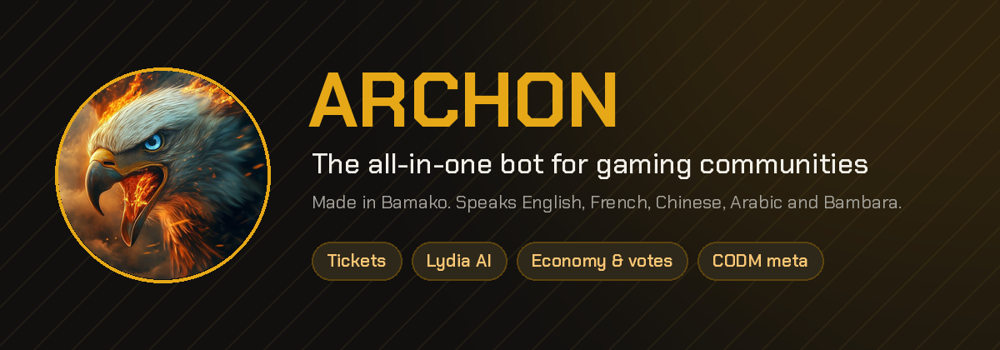
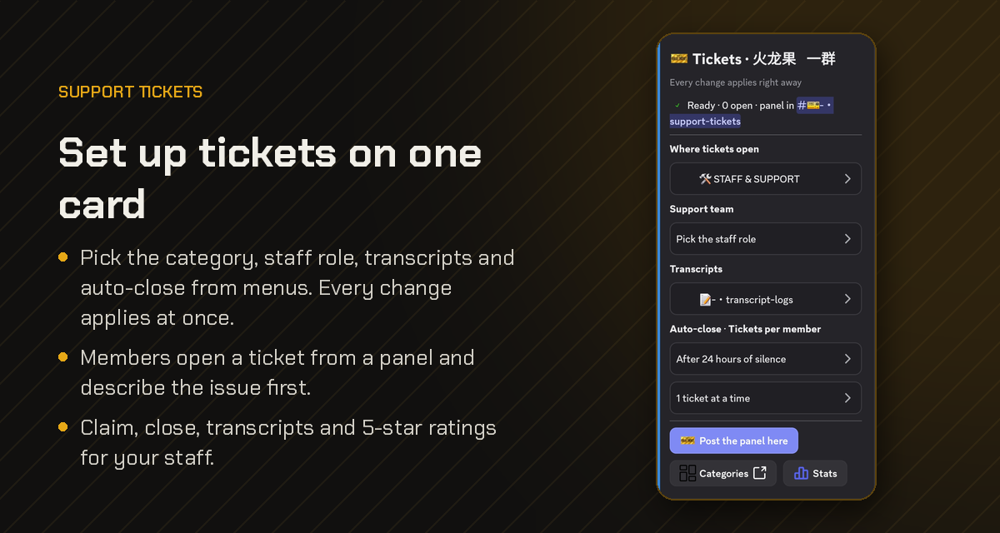
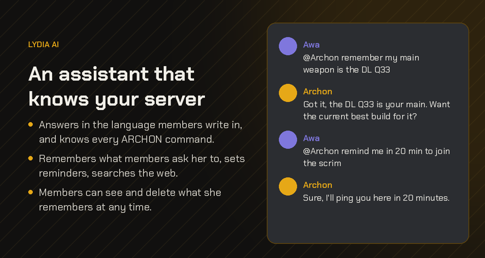
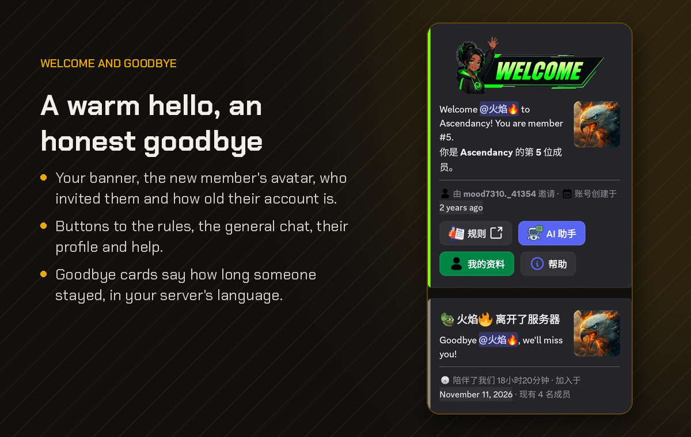
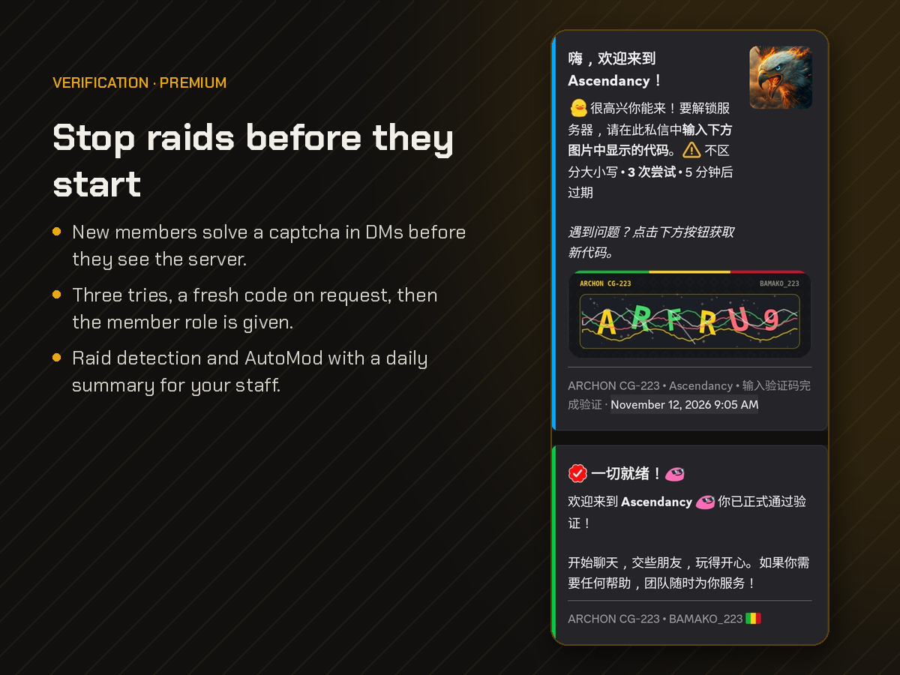
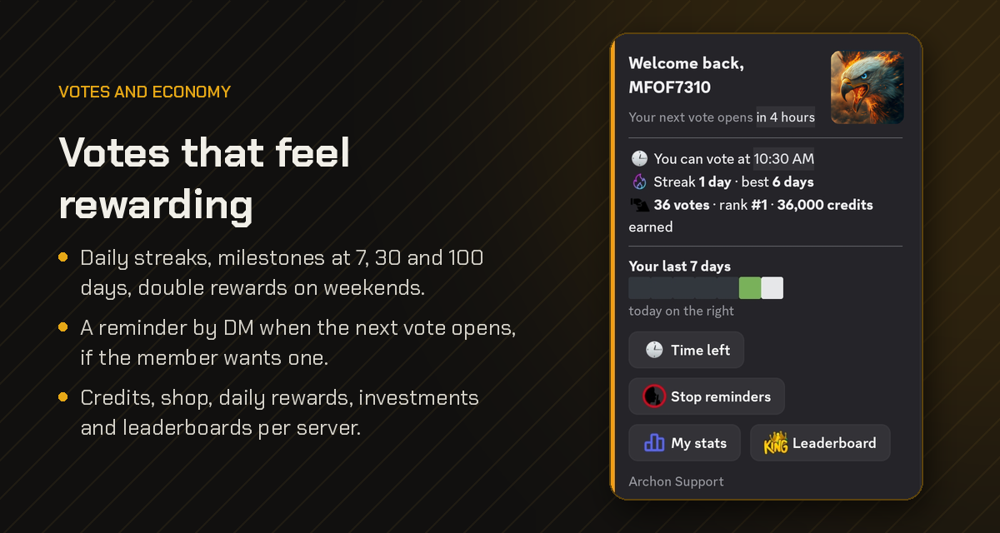
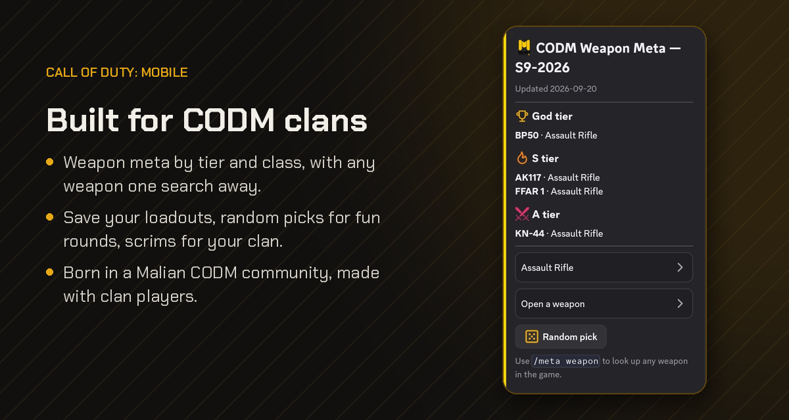

<p align="center">
  
</p>

<p align="center">
  <a href="https://discord.com/oauth2/authorize?client_id=1472707869257367676&permissions=2253174475189494&scope=bot%20applications.commands"></a>
  <a href="https://top.gg/bot/1472707869257367676/vote"></a>
  <a href="https://bamako-steel-dev.xyz"></a>
</p>

<p align="center">
  
  
  
  
  
</p>

<p align="center">
  <b>One bot for your whole Discord server.</b><br>
  Tickets, AI chat, welcome cards, verification, economy and Call of Duty Mobile tools,<br>
  set up from Discord or from the dashboard. Built and run from a phone in Bamako, Mali 🇲🇱
</p>

---

## What it does

<p align="center"></p>

**Tickets.** Set everything up from one live card in Discord: where tickets open, the staff role, transcripts, auto-close, the limit per member. Members open a ticket with a button, staff claim it, and every closed ticket leaves a transcript and a 5-star rating.

<p align="center"></p>

**Lydia, the AI assistant.** Mention her and she answers in the member's own language, remembers what members ask her to, searches the web when a question needs it, and can change server settings after an admin confirms. Free servers get 30 messages per member per day.

<p align="center"></p>

**Welcome and goodbye.** A card with your banner, the new member's avatar, who invited them and how old their account is, with buttons to your rules and channels. When someone leaves, a short card says how long they stayed.

<p align="center"></p>

**Verification and AutoMod.** New members can be asked to solve a captcha in their DMs before they see the server (Premium). AutoMod handles spam, links, invites and mass mentions with a clear strike ladder, members can appeal from the strike card, and the owner gets one summary a day instead of a ping for every message.

<p align="center"></p>

**Votes and economy.** Credits, daily rewards, a shop, investments, giveaways and leaderboards, kept separately for each server. Voting on Top.gg pays credits, doubled on weekends, with streaks and an opt-in reminder.

<p align="center"></p>

**Call of Duty Mobile.** Weapon tier lists, loadouts, scrims and game profiles, made with clan players from a Malian CODM community.

### Also inside

- **Dashboard** at [bamako-steel-dev.xyz](https://bamako-steel-dev.xyz): Discord login, every module on its own page, works on a phone
- **Alerts** for YouTube uploads, YouTube lives and TikTok posts
- **Moderation**: warnings, timeouts, kicks, bans, logs and raid detection
- **Leveling** with role rewards, birthdays, polls, reminders and mini-games
- **Telegram**: a companion bot for groups, with moderation, welcome messages and filters
- **Four languages** for every card and message: English, French, Chinese and Arabic

### Premium

Everything above is free except where it says Premium. Premium, at **$3.40 per server per month**, adds Lydia's server actions, AI model choice, raid detection, captcha verification, advanced AutoMod (image spam, `@everyone` spam) and priority support.

---

## Run it yourself

You need Node.js 18 or later and a Discord application ([developer portal](https://discord.com/developers/applications)).

```bash
git clone https://github.com/MFOF7310/archon-bot.git
cd archon-bot
npm install
cp .env.example .env      # fill in DISCORD_TOKEN, CLIENT_ID and OWNER_ID
npm start
```

Only those three values are required. Every other line of `.env.example` turns on an optional feature and explains itself (AI keys, Top.gg, Telegram, the dashboard API, payments).

To keep it running on a server:

```bash
npm install -g pm2
pm2 start index.js --name Architect-CG223
pm2 save && pm2 startup
```

<details>
<summary><b>Android (Termux)</b></summary>

```bash
pkg update && pkg install nodejs git python ffmpeg
git clone https://github.com/MFOF7310/archon-bot.git
cd archon-bot && npm install
cp .env.example .env
npm start
```

</details>

<details>
<summary><b>Optional tools</b></summary>

- **ffmpeg** and **yt-dlp** for media features and the YouTube fallback
- **An OpenRouter key** (`OPENROUTER_API_KEY`) for Lydia and AI moderation
- **The dashboard** lives in its own repository and reads the bot's API

</details>

### Project layout

| Folder | What's in it |
|---|---|
| `plugins/` | One file per command or module |
| `lib/` | Shared code: settings, i18n, cards, handlers |
| `lang/` | Every text the bot shows, one folder per language |
| `telegram/` | The Telegram bot and its plugins |
| `config/` | Changelog, emoji map (`emojis.example.js`) |
| `scripts/` | Command deploy and database backup |

---

## Translations

| Language | Status |
|---|---|
| English | Complete |
| French | Complete |
| Chinese (Simplified) | Complete |
| Arabic | Complete |
| Bambara | Started, needs native speakers |

Want to help? Read [TRANSLATING.md](TRANSLATING.md). Bug reports and ideas are welcome too: see [CONTRIBUTING.md](CONTRIBUTING.md), and report security issues privately as [SECURITY.md](SECURITY.md) explains.

---

## About

ARCHON CG-223 is written by **Moussa Fofana** ([@MFOF7310](https://github.com/MFOF7310)) in Bamako, Mali. It isn't a fork: it was built from scratch, entirely from a Samsung Galaxy Z Fold through Termux and SSH.

Questions or feedback: join the [Eagle Community](https://discord.gg/NFSMFJajp9) on Discord.

<p align="center">MIT licence · see <a href="LICENSE">LICENSE</a></p>
